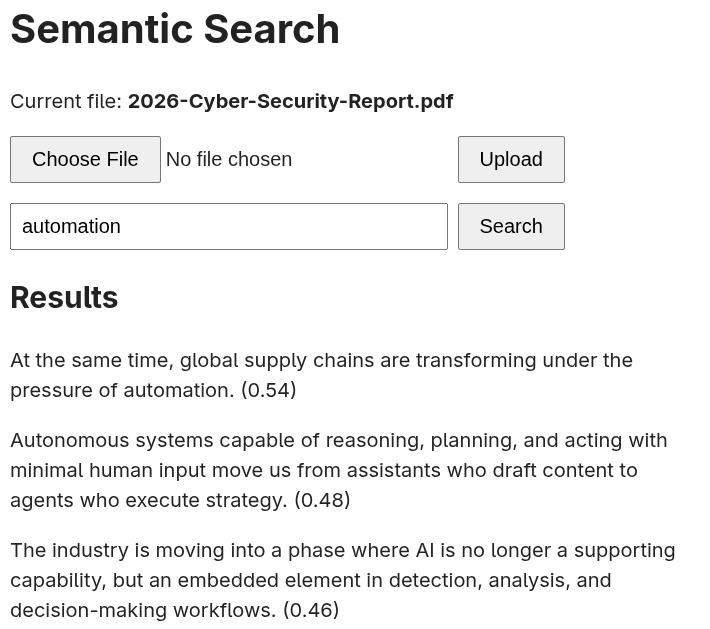

# AI Semantic Search Tool



A prototype search tool that finds text based on meaning, not just keywords.
You upload a document, ask a question in your browser, and it finds the most relevant sentences using an AI model.

---

## How the AI Works

Here's how it works under the hood:

### 1. Sentence splitting (NLTK)

- The document is read and split into sentences, so each sentence can be searched on its own.

### 2. Embeddings (Sentence-BERT)

- Both the sentences and user queries are encoded into vectors using Sentence-BERT.
- These embeddings capture semantic meaning, so that even differently worded texts can be recognized as similar.

### 3. Vector Indexing (FAISS)

- All sentence embeddings are stored in a FAISS index (IndexFlatIP) for fast similarity search.
- When a query is submitted, its embedding is compared to the stored ones to find the nearest matches.

### 4. Similarity Scores (cosine similarity)

- Each result includes a **similarity score**, calculated using **cosine similarity** between the query and each sentence.
- A score close to **1.0** means high semantic overlap; a score closer to **0.0** means weak or no similarity.
- For example, `(0.89)` means the model finds that result highly relevant to the query's meaning.

## Tech Stack

- **Python 3.11+**
- **Flask** for the web UI
- **Sentence-BERT** (all-mpnet-base-v2 model) for text embeddings
- **FAISS** (IndexFlatIP) for vector similarity search
- **NLTK** for sentence splitting

## Getting Started

```bash
python -m venv venv
source venv/bin/activate
pip install -r requirements.txt
python src/app.py
```

Then open http://127.0.0.1:5000 in your browser, upload a file and write a question.
