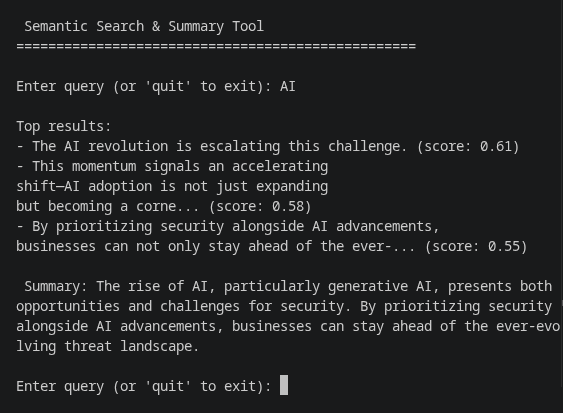

# AI Semantic Search Tool

A prototype AI-powered search tool that finds text based on meaning, not just keywords.
It turns text into vector embeddings, finds the passages that are semantically closest to your query, and generates concise summaries.
It's a prototype showing how modern NLP can make search more accurate, flexible, and human-like.

---

## How the AI Works

This tool uses modern NLP and vector search to retrieve passages based on meaning rather than exact words. Here's how it works under the hood:

### 1. Embeddings (Sentence-BERT)

- Both the text passages and user queries are encoded into vectors using Sentence-BERT.
- These embeddings capture semantic meaning, so that even differently worded texts can be recognized as similar.

### 2. Vector Indexing (FAISS)

- All embeddings are stored in a FAISS index that enables fast and scalable similarity search.
- When a query is submitted, its embedding is compared to the stored ones to find the nearest matches.

### 3. Similarity Scores (cosine similarity)

- Each result includes a **similarity score**, calculated using **cosine similarity** between the query and each passage.
- A score close to **1.0** means high semantic overlap; a score closer to **0.0** means weak or no similarity.
- For example, `(score: 0.89)` means the model finds that result highly relevant to the query's meaning.

## Tech Stack

- **Python 3.11+**
- **Sentence-BERT** (all-mpnet-base-v2 model) for text embeddings
- **FAISS** (IndexFlatIP) for fast vector similarity search
- **NLTK** for sentence tokenization
- **BART** (facebook/bart-large-cnn) for AI summary generation
- **PyPDF2** for PDF text extraction

## Features

- **Semantic search** - Find text based on meaning, not just keywords
- **AI-generated summaries** - Automatic summaries of search results using BART (facebook/bart-large-cnn)
- **Multi-format support** - Automatically loads and indexes .txt, .md, and .pdf files from data directory
- **Plug-and-play** - Just drop files in ./data/ folder and run - no configuration needed

## Language Support

- Uses the **all-mpnet-base-v2** model, which supports English and multiple other languages
- Produces 768-dimensional embeddings (higher quality than the previous all-MiniLM-L6-v2 model)
- Model size: ~420MB (automatically downloaded on first run)
